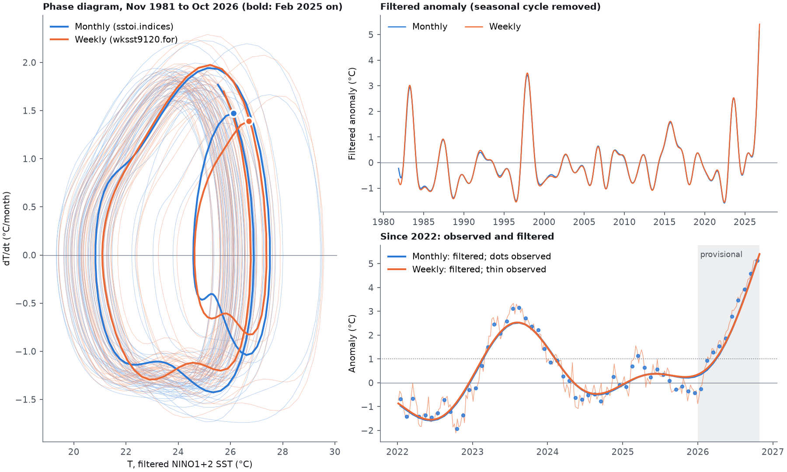

# Methods

Every number on the site is computed in Python from `config.yaml` and the
committed records; the pages only draw it.

## Records

| Dataset | Source | Shown as |
|---|---|---|
| NINO1+2 | NOAA CPC `sstoi.indices`, absolute SST (1975 to 1981 from the legacy file) | °C, seasonal cycle kept |
| NINO3, NINO3.4, NINO4 | NOAA CPC anomaly columns (NOAA's own climatology) | °C anomaly |
| NINO1+2 weekly (dataset `nino12w`; the file also holds NINO3, 3.4, 4) | NOAA CPC `wksst9120.for`, OISST weekly SST and SSTA from the week of 2 Sep 1981 | `data/weekly/wksst.csv`; see "Weekly SST" |
| Callao, La Libertad, Honolulu, Palau | UHSLC hourly tide gauges (Fast Delivery, extended with RAPID), monthly means needing 50% of hours | mm, seasonal cycle kept, minus the window mean |

Download and monthly averaging are ported unchanged from `el_nino`
(`src/enso/download.py`). Internal gaps of a few months are filled there and
flagged (`gap_filled` in `data/series/*.csv`).

## Filter

Ported unchanged from `el_nino` (`src/enso/fourier.py`; checked against the
Fortran loops in `tests/test_fourier.py`, and identical to the old pipeline's
output on the same input):

1. The analysis window ends at the latest month and starts in 1975, in the
   month after the end month, so it spans whole 12-month cycles.
2. For records with a seasonal cycle, the window's monthly climatology is
   removed, the anomaly is low-pass filtered (half-range sine expansion,
   HN1 = 10, HN2 = 9: full periods under about 18 to 20 months removed), and
   the climatology is added back. NOAA anomalies are filtered directly.
3. The filtered series is Fourier-interpolated to 5 points per month and
   differentiated analytically, giving dT/dt.

The time panel's bold line is the filtered anomaly from step 2, before the
climatology is added back.

## Provisional end

**`provisional_months: 10`: filtered values within 10 months of the end are
revised by 1.5 to 3 times more than older ones when new months arrive,
which matches the filter's longest half-period, HN1 = 10 months.**

The filter's detrending pins the last filtered value to the latest
observation, so the end of the record is constrained by one point instead of
by neighbours on both sides. `scripts/hindcast.py` measures the effect: it
cuts the record at 60 past end months, reruns the analysis, and compares
each run's values with what the full record now gives. RMS revision, as a
fraction of the series' standard deviation (data of November 2026):

| Months before the end | 0 | 2 | 4 | 6 | 8 | 10 | 12 | 16 | 20 | 24 |
|---|---|---|---|---|---|---|---|---|---|---|
| NINO1+2 value | 0.25 | 0.12 | 0.10 | 0.10 | 0.09 | 0.07 | 0.05 | 0.07 | 0.04 | 0.03 |
| NINO3.4 value | 0.50 | 0.23 | 0.21 | 0.25 | 0.21 | 0.13 | 0.09 | 0.13 | 0.06 | 0.07 |
| Callao value | 0.51 | 0.30 | 0.22 | 0.23 | 0.21 | 0.16 | 0.15 | 0.16 | 0.13 | 0.14 |
| NINO3.4 rate | 1.26 | 0.94 | 0.57 | 0.30 | 0.32 | 0.38 | 0.33 | 0.14 | 0.20 | 0.10 |

Values settle to a background level (about 0.05 to 0.15; the window start
also moves with the end) after 10 to 12 months. Rates are noisier and keep
some revision a little longer, which is why the readout always calls the
latest rate provisional. The readout shows the observed value of the latest
month, not a filtered one.

## Running event

**`current_event.threshold: 1.0` °C**: the 2025-26 highlight is switched on
when the latest monthly NINO1+2 anomaly is at least 1.0 °C.

The value is borrowed from ENFEN's coastal El Niño index (ICEN; ENFEN, Nota
Técnica ENFEN 01-2012, **to verify**: citation from memory), whose categories are weak 0.4 to 1.0, moderate 1.0 to 1.7,
strong 1.7 to 3.0 and extraordinary above 3.0 °C. It is used here only as a
trigger. Our value is **not an ICEN**: the ICEN is a 3-month running mean of
ERSST anomalies of NINO1+2, while ours is a single month of NOAA OISST
(`sstoi.indices`) against the analysis window's climatology for that
calendar month, so it is never reported as an ICEN class. In September 2026
it is +4.60 °C (NOAA's own anomaly, against 1991 to 2020: +4.69 °C).

## Compare: normalisation

Each record is drawn as x_n = (x − mean) / σx and y_n = (dx/dt) / σx, with
the mean and the sample standard deviation σx of its filtered values over its
window (as in the old `compare.html`). Using σx on both axes keeps each
loop's shape, so a taller loop moves faster relative to its own typical
swing. The alternative y / σ(dx/dt) was rejected: it makes every loop equally
tall and hides that difference.

The time strip instead shows each record's filtered anomaly (step 2 of the
filter, seasonal cycle removed) divided by that anomaly's own standard
deviation, so events line up across records whatever their seasonal swing.
The model has no real calendar and is left off the time strip.

## Weekly SST

**On the site as "NINO1+2 weekly"** (Phase diagrams and Compare, after
NINO1+2; monthly stays the default). Periods are dates (the Wednesday), the
loop has a point per week, the animation speeds are in weeks per second, the
provisional zone is 43 weeks, and Compare plays it beside monthly records on a
shared monthly calendar (each calendar point shows the week nearest its date).
The footer, "last checked" and `enso.status --behind` cover the weekly file.
The SST writer (`python -m enso.publish --source-type
noaa_sst`, in CI) also downloads NOAA CPC's weekly indices
(`wksst9120.for`) into `data/weekly/wksst.csv`; `src/enso/weekly.py` holds
the parser and the analysis, `scripts/weekly_vs_monthly.py` the comparison
below.

**The file** (checked on the copy of 4 November 2026): weekly OISST means
of NINO1+2, NINO3, NINO3.4 and NINO4, SST and SSTA (anomaly against 1991 to
2020), 2357 weeks from the week centred on **2 September 1981** (not 1990)
to the week centred on 28 October 2026. Every date is a Wednesday, the
centre of a Sunday to Saturday week, and the weeks are exactly 7 days apart.
The rows are fixed width (62 characters) and a negative SSTA touches the SST
before it (`20.6-0.1`), so the parser cuts columns by position and stops on
any change in the header, the row length or the 7-day step. The file of
4 November ends with the week centred on 28 October: a week is public about
7 days after its centre.

**Method**: the monthly one in weekly units.

1. Window: whole years ending at the latest week, the first week chosen at
   the same seasonal phase as the week after the last one (the monthly "start
   in the month after the end month"). Weeks do not divide a year, so the
   span is a whole number of years to within half a week. With the data of
   4 November 2026: 4 Nov 1981 to 28 Oct 2026, 2348 weeks, 45 years.
2. NINO1+2: the window's seasonal cycle is a least-squares fit of a mean plus
   **4 annual harmonics** on the day of the year (on the 365.2425-day mean
   year, so leap days add no jump), the weekly counterpart of the monthly
   climatology (`weekly.harmonics` in `config.yaml`). Against NOAA's own SSTA,
   after removing the mean offset of the different base periods
   (−0.035 °C), the anomalies differ by 0.079 °C RMS; 2 and 3 harmonics give
   0.144 and 0.088, 5 and 6 give 0.084 and 0.085. NOAA's SSTA is used only for
   this check (and filtered directly for NINO3, 3.4, 4, as monthly).
3. passa_baixa and deri_fourier count in samples: HN1 = 10 × 30.4375 / 7 =
   43.48 weeks, HN2 = 9 × 30.4375 / 7 = 39.13 weeks, NDOTS = 1. The rate per
   week is multiplied by 30.4375 / 7, so dT/dt is in °C/month as for the
   monthly record. `tests/test_weekly.py` checks the units on a sine of known
   period, and that weekly and monthly agree on one synthetic signal sampled
   both ways (0.03 °C in T, 2% of the spread in dT/dt).

**Provisional zone: 10 months (43 weeks) holds.** `scripts/hindcast.py
--weekly` (cuts every 13 weeks, lags in weeks, printed in months). RMS
revision as a fraction of the standard deviation, data of 4 November 2026:

| Months before the end | 0 | 2 | 4 | 6 | 8 | 10 | 12 | 16 | 20 | 24 |
|---|---|---|---|---|---|---|---|---|---|---|
| NINO1+2 value, weekly | 0.26 | 0.13 | 0.10 | 0.11 | 0.10 | 0.08 | 0.06 | 0.07 | 0.04 | 0.04 |
| NINO1+2 value, monthly | 0.23 | 0.12 | 0.10 | 0.11 | 0.09 | 0.07 | 0.06 | 0.06 | 0.03 | 0.05 |
| NINO1+2 rate, weekly | 0.19 | 0.15 | 0.10 | 0.07 | 0.06 | 0.07 | 0.09 | 0.05 | 0.05 | 0.06 |
| NINO3.4 value, weekly | 0.55 | 0.26 | 0.21 | 0.24 | 0.21 | 0.14 | 0.09 | 0.12 | 0.06 | 0.07 |
| NINO3.4 rate, weekly | 1.26 | 0.95 | 0.61 | 0.32 | 0.31 | 0.36 | 0.33 | 0.14 | 0.19 | 0.11 |

Values settle after 10 to 12 months as in the monthly record: the
revision is set by the filter's half-period, which is the same time span in
both. (The monthly rows here use the site's 1975 window, the weekly ones
the 1981 window.)

### Weekly against monthly, NINO1+2

Same window for both: Nov 1981 to Oct 2026 (540 months; 2348 weeks),
`python scripts/weekly_vs_monthly.py`, data of 4 November 2026.

| | Weekly − monthly, RMS at mid-month | Monthly standard deviation | Correlation |
|---|---|---|---|
| T (seasonal cycle kept) | 0.116 °C | 2.238 °C | 0.999 |
| dT/dt | 0.111 °C/month | 1.104 °C/month | 0.995 |
| Filtered anomaly | 0.048 °C | 0.979 °C | 0.999 |

Leaving out the provisional end changes none of these by more than 0.002.

**What is sampling and what is climatology.** The monthly analysis rerun
with the weekly method's seasonal cycle (mean plus 4 harmonics on the day of
the year, fitted to the monthly values at mid-month) instead of its 12
monthly means, same window:

| RMS difference | T (°C) | dT/dt (°C/month) | Filtered anomaly (°C) |
|---|---|---|---|
| Monthly, 12 means against monthly, 4 harmonics (climatology) | 0.009 | 0.006 | 0.006 |
| Weekly against monthly with 4 harmonics (sampling and source) | 0.115 | 0.111 | 0.047 |
| Weekly against monthly with 12 means (published default) | 0.116 | 0.111 | 0.048 |

The choice of climatology explains almost nothing: 4 harmonics reproduce
the 12 monthly means to 0.009 °C. The whole difference is between the two
records. It is not a date convention (shifting the weekly cycle by the best
whole day, −1, still leaves 0.080 °C), but a small difference in the
seasonal cycle of the two NOAA products: the annual harmonic has amplitude
2.86 °C in the monthly record and 2.75 °C in the weekly one (4% less), and
the phase differs by 1.1 days. The anomalies, once the cycle is removed,
agree to 0.047 °C and the rate of the anomaly alone to 0.010 °C/month (its
spread: 0.164). The loops in the figure have the same shape and timing; the
weekly one sits slightly inside the monthly one where the seasonal swing is
largest.

Averaging cannot explain the smaller weekly annual cycle. A one-month boxcar
mean reduces a 12-month sinusoid by sinc(π/12) ≈ 0.989 (1.1%) and a one-week
mean by about 0.06%, so the weekly cycle should be slightly larger than the
monthly one, not 4% smaller. The difference most likely comes from different
processing of the two NOAA products (grid, analysis version or averaging); it
is to be checked against the NOAA CPC documentation. It is a property of the
files and does not depend on the filter. **Weekly and monthly NINO1+2 should
therefore not be mixed in quantitative comparisons**: their shapes and timing
agree, but their absolute values and seasonal swing differ.

Peaks of the filtered anomaly (the time panel's bold line) and of the
observed anomaly, inside each event's months (`config.yaml` events):

| Event | Filtered, monthly | Filtered, weekly | Observed, monthly | Observed, weekly |
|---|---|---|---|---|
| 1997-98 | Nov 1997, +3.42 | 26 Nov 1997, +3.50 | Dec 1997, +3.74 | 10 Dec 1997, +4.01 |
| 2015-16 | Sep 2015, +1.57 | 16 Sep 2015, +1.61 | Jul 2015, +2.37 | 15 Jul 2015, +2.59 |
| 2023-24 | Aug 2023, +2.53 | 9 Aug 2023, +2.53 | Aug 2023, +3.16 | 19 Jul 2023, +3.34 |
| 2025-26 (running) | Oct 2026, +5.14 | 28 Oct 2026, +5.41 | Oct 2026, +5.14 | 28 Oct 2026, +5.41 |

Filtered peaks fall in the same month and agree within 0.08 °C; observed
weekly peaks are 0.18 to 0.27 °C higher because a single week is not averaged
over a month. The 2025-26 values are still rising and sit in the provisional
zone, where the filtered value equals the latest observation.

**SIGMA30** (RMS of filtered − observed): monthly 0.490 °C, weekly
0.570 °C. The weekly record keeps the sub-monthly variability that the
monthly mean already averaged out, and the filter removes it.

**How much earlier the weekly record sees the event.** A replay of every
update since July 2024, each record as it was public at the time (monthly:
month m on the 4th of month m + 1; weekly: 7 days after the week's centre),
each with its own window and seasonal cycle, testing the latest anomaly
against `current_event.threshold` (1.0 °C). The filtered anomaly ends exactly
on the latest observation, so this is also the end of the phase loop.

| | Monthly | Weekly | Weekly earlier by |
|---|---|---|---|
| First at or above 1.0 °C | public 4 Apr 2025 (March 2025) | public 5 Mar 2025 (week of 26 Feb) | 30 days |
| At or above 1.0 °C ever since | public 4 Apr 2026 (March 2026) | public 11 Mar 2026 (week of 4 Mar) | 24 days |

In general the latest monthly value is 18 to 49 days old (mean about 33)
from the middle of its month, the latest weekly value 7 to 14 days (mean
about 10): the weekly record is about 3 weeks fresher, and its last point
lies about 2 weeks further along the loop (in the figure, 28 October against
mid-October: 26.7 against 26.1 °C).

## Duffing model

X″ = K1·X + K3·X³ + FA·cos(W·t − FF) + B·X′ (right-hand side ported unchanged
from `el_nino/src/el_nino/duffing.py`), integrated with scipy RK45
(rtol 1e-6, atol 1e-8).

- Presets: the El Niño fit (the Java applet's coefficients, not re-fitted)
  and the chaotic benchmark x″ + 0.02x′ − x + x³ = 3 sin t. Five forcing
  amplitudes each (0.5 to 1.5 times the preset).
- Each run is **one long trajectory**: 100 forcing cycles discarded, then
  1500 cycles kept. The Poincaré section is that trajectory sampled once per
  forcing cycle at a chosen phase (12 phases), not a cloud of starting points.
- **Lyapunov exponents** (Benettin et al. 1980): the trajectory is integrated
  with two tangent vectors through the variational equations
  δX′ = δY, δY′ = (K1 + 3K3·X²)·δX + B·δY (RK45, rtol 1e-9), and the vectors
  are re-orthonormalised (QR) once per forcing cycle. 1500 cycles are
  integrated after the transient; the first half is discarded as well,
  because some runs stay chaotic for hundreds of cycles before settling
  (transient chaos), and the exponents are the mean over the second half.
  The standard error comes from 20 blocks. The estimate counts as converged
  when the two halves of that window agree within 6 standard errors (or the
  zero band). Built-in check: the flow's divergence is B everywhere, so
  λ1 + λ2 = B × period exactly; every run meets it to about 1e-9. A second
  check: a stable periodic orbit whose Floquet multipliers are complex
  (it spirals in) has λ1 = λ2 = B × period / 2. The El Niño fit at ×1.5
  (−2.128 = −0.35465 × 12 / 2) and the chaotic benchmark at ×1.25 and ×1.5
  (−0.063 ≈ −0.02 × 2π / 2) show exactly that.
- **Robustness**: every run is estimated a second time with another
  integrator (DOP853) at a 10 times tighter tolerance (rtol 1e-10,
  atol 1e-12), from its own trajectory. For the El Niño fit at ×1 this gives
  λ1 = +0.668 ± 0.007 per forcing cycle against +0.655 ± 0.009 with RK45
  (1.1 combined standard errors apart). Periodic runs agree to the 4th
  decimal; every run keeps its class. The page shows both values.
- **Kaplan-Yorke dimension** of the Poincaré section (a 2-D map with
  exponents λ1 ≥ λ2 per cycle): D = 1 + λ1 / |λ2| when λ1 > 0, and 0 when
  λ1 < 0 (the section is a finite set of points). Its standard error follows
  from λ1's, since λ1 + λ2 = B × period is fixed. The El Niño fit at ×1:
  D = 1.13; the chaotic benchmark at ×1: D = 1.81. A dimension close to 1
  is why the strongly damped El Niño fit's section looks like a curve.
  D is the dimension **of the Poincaré section**, and the page labels it
  so. The attractor of the flow (the loop in the phase diagram) has one
  more dimension, D + 1, the direction along the trajectory: a periodic
  run has D = 0 on the section (a finite set of points) and dimension 1 in
  the flow (a closed loop); the El Niño fit at ×1 has 2.13 in the flow.
- **Classification** by the largest exponent λ1, per forcing cycle:
  chaotic if λ1 > max(3 SE, 0.01), periodic if λ1 < −max(3 SE, 0.01),
  quasi-periodic otherwise. A separate check on the section run (points
  recurring after n cycles, n up to 24) gives the period of periodic runs;
  it agrees with the classification for every run.
- **Sweep** (not on the site yet): `scripts/lyapunov_sweep.py` repeats the
  estimate for the El Niño fit at 101 forcing amplitudes, ×0.5 to ×1.5 in
  steps of 0.01, and writes `data/model/lyapunov-sweep-alado.csv` and `.png`.
  The five published factors come back with identical values. Chaos fills
  bands at ×0.59 to ×0.65, ×0.67 to ×0.79, ×0.81 to ×0.84, ×0.86 to ×0.94
  and ×0.96 to ×1.04, separated by narrow periodic windows (single steps at
  ×0.66, ×0.80, ×0.85 and ×0.95); from ×1.05 up every run is periodic. The
  preset (×1) lies in the last band, 5% from a periodic window on either
  side, so the fit's chaos is real but not robust to a small change in FA. Where λ1 crosses zero at an
  isolated amplitude (×1.12, labelled quasi-periodic by the rule above) the
  run sits at a bifurcation of a periodic orbit, not on a torus.
- Runs are cached in `data/model/` (`python -m enso.model`). A chaotic
  trajectory depends on every last bit of floating-point arithmetic, so the
  cache, not a rerun on another machine, defines the published pages.
